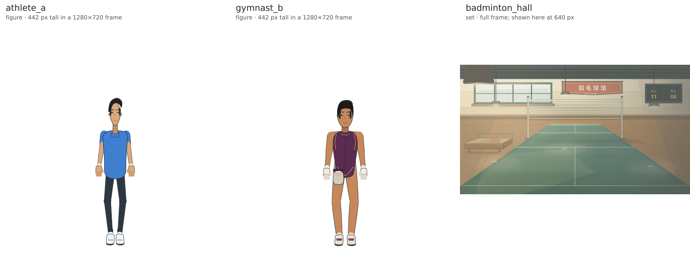

# agentic-animation

[English](README.md) | **简体中文**


一个由智能代理操作的工具链：把写好的故事变成带旁白的、确定性的 2D 动画 MP4。

**画面里的每一个动作都是代码——分层木偶骨架、类型化的表演调用和关键帧，最后交给 Remotion 渲染——所以同样的输入和随机种子每次都会跑出同样的帧，全程不碰生成式视频。** 生成式静态图只允许用来做资产；动作从不交给模型。故事源、图像生成、TTS、口型同步、音乐和渲染器都是可替换的适配器，在 `anim.config.json` 里选；设置 `ANIM_CORPUS_ROOT` 可以额外启用印度神话语料库。

## 效果展示

下面都是仓库里真实存在的成片，可直接在 GitHub 上播放：

<video controls preload="metadata" width="640" src="https://media.githubusercontent.com/media/ZisIsNotZis/agentic-animation/main/episodes/ai-work-adventure/dist/ai-work-adventure.mp4"></video>
[观看《AI 打工奇遇记》](https://media.githubusercontent.com/media/ZisIsNotZis/agentic-animation/main/episodes/ai-work-adventure/dist/ai-work-adventure.mp4)

<video controls preload="metadata" width="640" src="https://media.githubusercontent.com/media/ZisIsNotZis/agentic-animation/main/episodes/bailan-system/dist/bailan-system.mp4"></video>
[观看 Bailan System](https://media.githubusercontent.com/media/ZisIsNotZis/agentic-animation/main/episodes/bailan-system/dist/bailan-system.mp4)

<video controls preload="metadata" width="640" src="https://media.githubusercontent.com/media/ZisIsNotZis/agentic-animation/main/episodes/liu-secret/dist/liu-secret.mp4"></video>
[观看 Liu Secret](https://media.githubusercontent.com/media/ZisIsNotZis/agentic-animation/main/episodes/liu-secret/dist/liu-secret.mp4)

引擎实际画出来的角色和场景，出自那份临时版选角评审（见 [`evidence/media/`](evidence/media/README.md)）：



## 快速开始

需要 Node 20+、npm、`ffmpeg` 和一个 POSIX shell。ComfyUI、Kokoro、Rhubarb 都是可选的，`anim doctor` 会报告它们的状态，但 smoke 流程不需要——它用的是仓库里自带的 `_placeholder` 木偶。

```sh
npm install                 # 整个 workspace 装一次就够
bash tools/setup.sh         # 校验工具链，装 uv、取 rhubarb，并列出可选服务
npm run typecheck           # 跨包 tsc --noEmit
npm test                    # 自足的单元测试（core + studio + stage lock）
npm run anim -- doctor      # 可执行的预检：系统 + 每个适配器
npm run smoke               # 在 /tmp 的隔离工程里跑规范 YAML 的 check + make
```

`npm run smoke` 会在 `/tmp` 里造一个最小的规范 `episode.yml`，跑 `check` 和 `make`，并断言生成的 performance 与音频清单；它不会碰仓库里的任何 episode。要跑真实的一集：

```sh
npm run anim -- check episodes/ai-work-adventure/episode.yml
npm run anim -- make  episodes/ai-work-adventure/episode.yml
npm run anim -- preview episodes/ai-work-adventure/episode.yml   # Remotion 预览
npm run anim -- render-yaml episodes/ai-work-adventure/episode.yml
```

`npm run anim -- --help` 会打印完整命令树。环境没问题时 `anim doctor` 全绿；在你自行安装之前，它会把 ComfyUI 和 Kokoro 标成 **未就绪**（`tools/setup-comfyui.sh`、`tools/setup-kokoro.sh`）。

## 现在能做什么

- **`episode.yml` 全链路打通。** 每集一份由代理编写的脚本；`check`、`make`、`preview`、`render-yaml` 就是全部公开接口。
- **类型化的内联调用。** 过程调用就放在台词里的同步点上——它会从语音音频和字幕里被切掉，所以表演和对白不会跑偏。
- **带物理的运动模型。** 骨架、可达范围、道具几何、支撑面和全身提案都在明确的不变量下求解；道具只会在几何允许的地方被拿、被击打或被放下。
- **双手持有道具。** 主手负责放置、递出和击打，副手负责绑定、携带、插槽和收回。
- **镜头也是一个调用。** `camera.follow(target, {sec, zoom})` 输出逐帧关键帧，并夹在舞台范围内。
- **确定性是契约。** 带种子的 PRNG、每个验收产物都绑内容哈希，外加一个 180 秒基准作为回归检查。
- **可替换的适配器。** `tts-edge`、`tts-kokoro`、`tts-espeak`、`tts-say`、`tts-dir`、`lipsync-rhubarb`、`imagegen-comfyui`、`music-raga`、`corpus-hindu-timeline`、`renderer-remotion`。
- **按类别装插件的资产库。** `library/<category>/plugin.js` 拥有这一类的语义，`library/<category>/<name>/` 放单个不可变资产；身份就是路径（`action.slam`、`figure/athlete_a`）。
- **给操作它的代理用的技能。** `.agents/skills/` 里是本地流程（做一集、造角色、QA 静帧、音频 QA、镜头调度、生产管线）；`tools/skill-audit.mjs` 负责审计。

## 架构

一份作者输入，一份编译产物，一个渲染器；下游不会再去读故事。

```text
episode.yml -> 校验后的源码 -> 插件发现 + 实测音频时序
  -> performance IR -> Remotion 帧 -> QA -> MP4
```

```text
packages/
  core/        schema（zod + 导出的 JSON Schema）、适配器接口、配置加载、
               产物存储、带种子 PRNG、运动模型、调用、插件
  cli/         `anim` CLI：check、make、preview、render-yaml、doctor、char
  adapters/    一个能力一个包：tts、lipsync、imagegen、music、corpus、renderer
  studio/      Remotion 工程：木偶运行时、构图、占位演员
library/       类别插件与不可变资产（figure、set、prop、voice……）
episodes/      每集一个工作区：episode.yml、素材源、交付 MP4
py/            uv 管理的 Python 边车（Kokoro TTS、部件切分）
tools/         安装、doctor、重任务锁、QA 与测量脚本
docs/          真相来源：问题、目标、需求、契约、管线
```

`packages/core` 是契约，`packages/cli` 是唯一入口，`packages/studio` 只消费编译后的 performance IR。坐标、骨架机制、过程配方和默认时长归资产与编译器契约管，永远不写进 episode 脚本；旧的 authoring 写法直接拒绝，而不是帮你翻译。

文档优先级归 [`docs/INDEX.md`](docs/INDEX.md)：层级越低越靠近目的，冲突时以它为准；[`docs/6_ARCHITECTURE.md`](docs/6_ARCHITECTURE.md) 是总设计，[`docs/9_PIPELINE.md`](docs/9_PIPELINE.md) 是操作顺序。

## 开发

```sh
npm run typecheck           # tsc --noEmit
npm test                    # 文档 lint + core、studio、stage-lock 单元测试
npm run test:all            # 再加上 packages/adapters/* 下的测试
npm run docs:lint           # 文档结构与来源分区检查
npm run schemas             # 从 zod schema 重新生成 docs/schemas/*.json
npm run validate:episode-yaml -- episodes/<slug>/episode.yml
node tools/prop-track.mjs episodes/a-badminton/performance.json shuttle 2.8 3.7
```

这里没有 CI：闸门就是改完树的这台机器上跑一遍 `npm run typecheck && npm test && npm run smoke`。动资产或契约，就要在同一个改动里更新拥有它的那份文档。

## 参与贡献

可复现的 bug 和设计问题走 Issue；改变了公开行为的 PR 要同步更新 `docs/` 里对应的文档，并带上针对性的测试或实测证据。见 [CONTRIBUTING.md](CONTRIBUTING.md) 和 [`docs/9_REPOSITORY_MAINTENANCE.md`](docs/9_REPOSITORY_MAINTENANCE.md)。

## 路线图

已完成——引擎这一里程碑已经收尾（`0.0.0`）：插件宿主引擎走通了规范 `episode.yml` 全链路，三个演示集（外加十四个展示与切片集）都能校验、编译和渲染，美术质量里程碑 M0–M7 都已给出结论。

- M6 电影语言与 M7 迁移——已交付，独立评审 PASS。
- M4 材质与 M5 表演——已交付，等本人判定。
- M2 角色与 M3 世界——判定达标；`figure/lin_b_draft` 是推荐的生产角色。

计划中——下一个包是 **R8：回合球自己的一包**：把接球方的手或球拍放到下落的羽毛球*将会*经过的位置，让回球来自一个人能写得出的调用（十一个采样时点里至少六个能打出第二拍）。它后面还有 **M8 默认生产**、切片 B（单杠大回环还 bake 不出来）和切片 C（茶室的 `intent pour`）。更远一点的想法是：一段写下来的故事，没有人碰关键帧就能变成一段能看的短片，并且每一帧都能从哈希复现。

诚实的边界：仓库里的 episode 是演示，不是产品，也不是成片；DSL、schema 和 IR 都还会破坏性变化；跨会话的渲染不确定性仍未关票。完整记录在 [`docs/0_ROADMAP.md`](docs/0_ROADMAP.md)。

## 许可

GNU Affero 通用公共许可证第 3 版（仅此版）——见 [LICENSE](LICENSE)。
